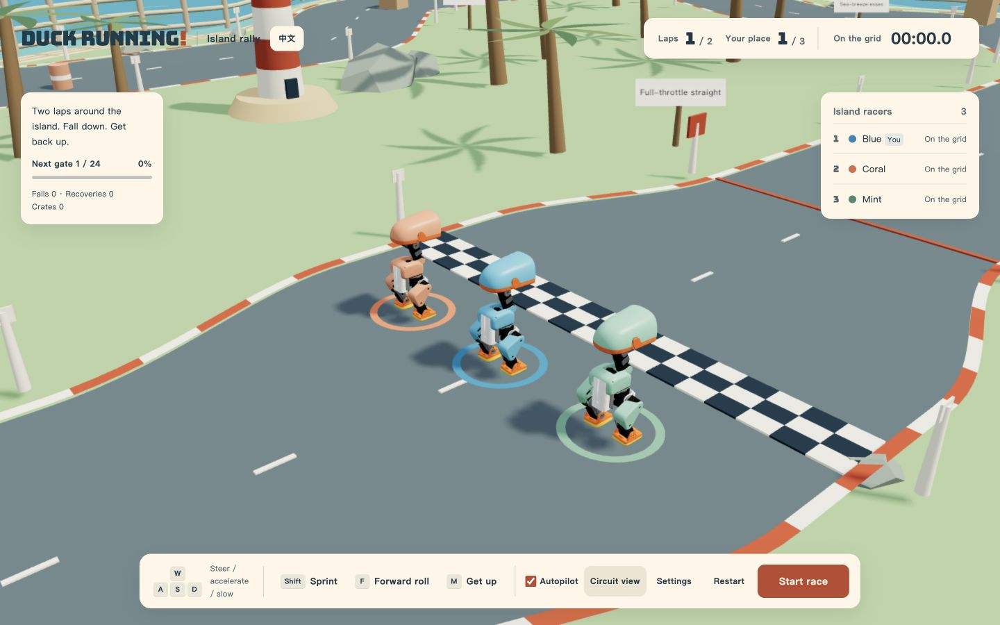

# duck running!

[English](README.md) · [简体中文](README.zh-CN.md)

**[GitHub Pages URL](https://wander521.github.io/microduck-running/)** — initial Pages setup and deployment are pending. Play locally with the steps below.

A tiny island. Three robot ducks. A very wobbly race.

A standalone browser racing game powered by **MuJoCo physics**, **Three.js**, and **ONNX control policies**. Sprint through coastal bends, crash into rivals, smash crates, roll forward, and get back up for another lap.



## Play locally

Requires **Node.js 22 or newer** and npm. Use a current desktop browser with WebGL and WebAssembly support. Desktop is the current target; mobile controls are deferred.

```sh
git clone https://github.com/wander521/microduck-running.git
cd microduck-running
npm ci
npm run dev
```

Open **http://127.0.0.1:5175/** (or the port shown by Vite). The first installation needs the internet; all game models, fonts, and simulation assets are served locally afterward. There is no multiplayer service or external inference API.

Use the **中文 / EN** button beside the title to switch language at any time. The game remembers your choice. Direct links `?lang=en` and `?lang=zh` override it.

## How the race works

- Three colour-coded racers: **Blue** (you), **Coral**, and **Mint**. Autopilot starts enabled; take over with the direction keys.
- Two laps around a continuous **29.21 m circuit**, with a long straight, coastal esses, a chicane, and a hairpin. Gates must be passed in order.
- Real physical contacts can knock ducks over. Learned recovery gets them moving again; **M** requests recovery manually.
- Crates break, barrels fly, and lightweight hurdles fall out of the way. Crate splinters are visual effects without collision.
- As soon as **any duck finishes**, a full **10-second countdown** begins. At zero, the race ends and the winner dances on the podium. Finishers rank by time; unfinished ducks rank by progress and are labelled accordingly.
- Pausing also pauses the final countdown and podium celebration.

| Input | Action |
| --- | --- |
| W / ↑ | Accelerate; take manual control |
| A / D or ← / → | Steer; take manual control |
| S / ↓ or E | Slow down |
| Shift | Sprint |
| F | Forward roll |
| M | Get up |
| Space | Start / pause / resume |
| R | Restart race |
| C | Restore follow camera |
| Mouse drag / wheel | Orbit / zoom |

Turn **Autopilot** back on in the dock to hand driving back. **Settings → Track assist** controls the player's bounded steering and return-to-line forces; opponents use the route guide. High-speed cornering and recovery can still fail—that wobble is part of the game.

## Development

```sh
npm test             # Course, controls, ten-second finish rule, and bilingual messages
npm run build        # Standalone static output in dist/
npm run preview      # Preview the production build
```

Optional physical diagnostics: `npm run check:race`, `check:roll`, `check:coast`, and `check:hurdles`. They write generated reports to the ignored `evidence/` folder. See [validation notes](docs/VALIDATION.md).

The build copies MuJoCo and ONNX WebAssembly files from the pinned npm packages into a generated local runtime directory. Static hosting must serve `.wasm` files correctly. For a subdirectory build and its local preview, set `BASE_PATH=/microduck-running/` for both `npm run build` and `npm run preview`.

```text
src/                  Rendering, game UI, translations, and physics integration
public/assets/        Robot geometry, five policy networks, and local font
public/licenses/      Upstream notices and licenses
scripts/              Runtime preparation and reproducible physics diagnostics
tests/                Course, control, and language checks
docs/                 Screenshots and validation notes
```


## GitHub Pages deployment

The included workflow installs dependencies with Node.js 22, runs tests, and builds with `/microduck-running/` as its base path. Once **Settings → Pages → Source** is set to **GitHub Actions**, pushes to `main` can publish to [GitHub Pages](https://wander521.github.io/microduck-running/). Pull requests only test and build. You can also run **Actions → Test and deploy** manually. Initial Pages enablement and a successful hosted deployment remain unverified.

## Models and scope

The race uses the existing **13194 fast-running checkpoint**, **6098 forward roll**, learned recovery, the official starting-stance policy, and a DuckEMW-derived champion dance. Autopilot is a route guide layered over the physical controller, not a trained multi-agent racing policy. Track assistance is bounded physical force/torque; it does not teleport roots or overwrite their velocity. This repository ships the playable game and exported policies, not the original remote training environment.

## Credits and licenses

Code is licensed under **Apache-2.0**; see [LICENSE](LICENSE). The bundled MicroDuck **3D geometry is CC BY-NC-SA 4.0**, including its noncommercial and share-alike conditions. The code license does not override asset licenses. Bungee uses SIL OFL 1.1. Full policy provenance, upstream projects, and dependency notices are in [THIRD_PARTY.md](THIRD_PARTY.md) and `public/licenses/`.

Thanks to [Pollen Robotics](https://github.com/pollen-robotics/microduck), [MicroDuck RL](https://github.com/pollen-robotics/microduck_rl), [the official simulator](https://huggingface.co/spaces/pollen-robotics/microduck-simulator), [DuckEMW](https://github.com/emwstudio/DuckEMW), and the credited policy contributors.
