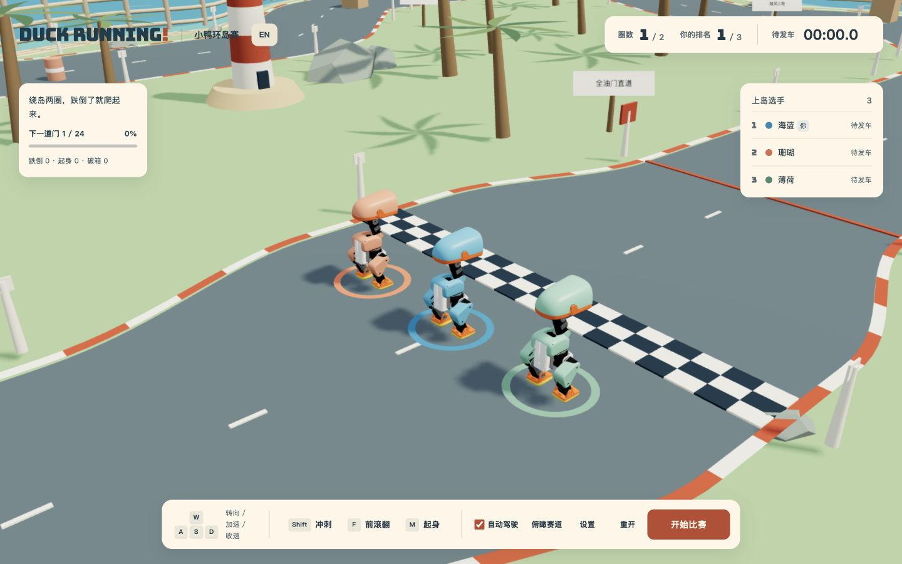

# duck running!

[English](README.md) · [简体中文](README.zh-CN.md)

**[GitHub Pages](https://wander521.github.io/microduck-running/)** · [本地运行](#本地运行)

一座小岛，三只机器鸭，一场跌跌撞撞的比赛。

独立运行的浏览器竞速游戏，使用 **MuJoCo 物理仿真**、**Three.js** 和 **ONNX 控制策略**。沿海岛弯道冲刺，撞飞路桶、撞碎木箱，摔倒后爬起来，继续追赶。



## 本地运行

需要 **Node.js 22 或更新版本**和 npm，以及支持 WebGL、WebAssembly 的桌面浏览器。目前以桌面体验为主，手机端暂未适配。

```sh
git clone https://github.com/wander521/microduck-running.git
cd microduck-running
npm ci
npm run dev
```

打开 **http://127.0.0.1:5175/**（若端口占用，以 Vite 显示的地址为准）。首次安装依赖需要联网，运行时模型、字体与仿真资源均由本地提供，不需要联机服务或外部推理 API。

标题旁的 **中文 / EN** 按钮可随时切换语言，并记住选择。也可使用 `?lang=zh` 或 `?lang=en` 链接指定语言。

## 比赛玩法

- 三只不同颜色的小鸭：**海蓝**（玩家）、**珊瑚**、**薄荷**。默认开启自动驾驶，按方向键可接管驾驶。
- 每圈 **29.21 米**，共两圈；包含长直道、沿海 S 弯、减速弯和发卡弯，需要按顺序通过检查门。
- 鸭子、对手和障碍物使用真实物理碰撞。跌倒后使用学习策略自动起身，也可按 **M** 手动起身。
- 木箱可破坏、路桶可弹飞，轻质跨栏撞倒后会让出道路。木箱碎片仅为视觉效果，不参与碰撞。
- **任意一只小鸭率先冲线**后启动完整的 **10 秒倒计时**。归零后统一结束，进入领奖台，由冠军跳舞庆祝。完赛者按时间排名，未完赛者按进度排列并明确标记。
- 默认跟随玩家小鸭，重开后同样恢复跟随。底栏可切换俯瞰海岛，按 **C** 可恢复跟随。
- 暂停比赛时，最后十秒倒计时和颁奖动画也会暂停。

| 操作 | 功能 |
| --- | --- |
| W / ↑ | 加速并接管驾驶 |
| A / D 或 ← / → | 转向并接管驾驶 |
| S / ↓ 或 E | 收速 |
| Shift | 冲刺 |
| F | 前滚翻 |
| M | 起身 |
| Space | 开始 / 暂停 / 继续 |
| R | 重新比赛 |
| C | 恢复跟随视角 |
| 鼠标拖动 / 滚轮 | 环顾 / 缩放 |

勾选底栏的**自动驾驶**可重新交回驾驶。**设置 → 赛道辅助**控制玩家的有限转向与回线力，对手使用路线引导。高速拐弯和起身仍可能失败，跌跌撞撞也是比赛的乐趣。

## 开发与构建

```sh
npm test             # 赛道、控制、首鸭冲线十秒规则和双语检查
npm run build        # 输出独立静态站点到 dist/
npm run preview      # 预览生产构建
```

可选物理诊断：`npm run check:race`、`check:roll`、`check:coast`、`check:hurdles`。生成记录写入被 Git 忽略的 `evidence/` 文件夹。参见[验证说明](docs/VALIDATION.md)与[性能测量](docs/PERFORMANCE.md)。`npm run check:performance` 可对比场景展示数据提取和线程传输量。

构建会从固定版本的 npm 依赖复制 MuJoCo 和 ONNX WebAssembly 到本地运行资源目录。静态服务器需正确提供 `.wasm` 文件。如需部署到子路径，构建与本地预览时均设置 `BASE_PATH=/microduck-running/`。

```text
src/                  场景渲染、游戏界面、翻译与物理接入
public/assets/        机器人几何、五个策略网络与本地字体
public/licenses/      上游许可和署名
scripts/              运行资源准备与可复现物理诊断
tests/                赛道、操作和语言检查
docs/                 游戏截图与验证说明
```


## GitHub Pages 部署

已提供的工作流使用 Node.js 22 安装依赖、运行测试，并以 `/microduck-running/` 为基础路径构建。将仓库的 **Settings → Pages → Source** 设为 **GitHub Actions** 后，推送 `main` 即可通过工作流发布到 [GitHub Pages](https://wander521.github.io/microduck-running/)。拉取请求只进行测试与构建，不部署。也可手动运行 **Actions → Test and deploy**。

## 策略与适用范围

比赛使用已接入的 **13194 极速跑**、**6098 前滚翻**、学习起身、官方发车站立和基于 DuckEMW 的冠军舞蹈策略。自动驾驶是在物理控制器之上添加路线引导，并非训练好的多智能体竞速策略。赛道辅助通过有限物理力和力矩实现，不瞬移根位姿、不覆盖根速度。本仓库提供可运行游戏和导出模型，不包含原来的远程训练环境。

## 来源与许可

代码采用 **Apache-2.0**，参见 [LICENSE](LICENSE)。捆绑的 MicroDuck **3D 几何采用 CC BY-NC-SA 4.0**，包括非商业和相同方式共享条件；代码许可不覆盖这些资源的许可。Bungee 字体采用 SIL OFL 1.1。策略来源、上游项目与依赖署名详见 [THIRD_PARTY.md](THIRD_PARTY.md) 和 `public/licenses/`。

感谢 [Pollen Robotics](https://github.com/pollen-robotics/microduck)、[MicroDuck RL](https://github.com/pollen-robotics/microduck_rl)、[官方模拟器](https://huggingface.co/spaces/pollen-robotics/microduck-simulator)、[DuckEMW](https://github.com/emwstudio/DuckEMW) 以及已署名的策略贡献者。
